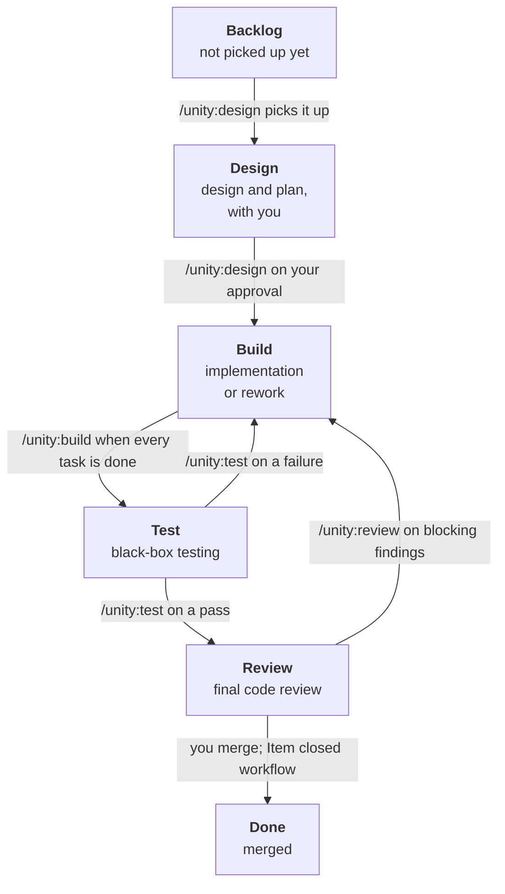

# Unity

**Unity** is a [Claude Code](https://claude.com/claude-code) plugin for a role-based development flow on GitHub: **design → build → test → review**. Each role runs in its own fresh session, and the GitHub issue, its pull request and a Project board are the only handoff between them.

## Motivation

One agent that designs, builds, tests and reviews its own work in a single conversation grades its own homework. Its context fills up with its own reasoning, and the further a session runs, the less that reasoning is questioned. Unity splits the work into four agents that don't share a context and don't take each other's word for it: the designer agrees the design and testable acceptance criteria with you, the builder implements them test-first, the tester checks the running system against the criteria as a black box, and the reviewer reads the result as someone who has to maintain it next year.

The workflow around them is deterministic. Every role reads the same inputs from GitHub, checks the board before it starts, and hands over through a fixed format: verdicts, coverage and counts are computed by scripts, not written by the agent. That is what makes the output scale. Each story arrives as one pull request with one commit per task, mapped to its acceptance criteria, tested from the outside and reviewed line by line, whether it is the first story in a project or the hundredth.

## Name

The name **Unity** is a wink to Unity, the hive mind from the Rick and Morty episode [Auto Erotic Assimilation](https://en.wikipedia.org/wiki/Auto_Erotic_Assimilation), who assimilates a whole planet into one perfectly coordinated mind. It fits: like Unity, this plugin makes almost anything possible, as long as you align to the workflow.

## Install

Unity builds on these, which it doesn't install itself:

- [Superpowers](https://github.com/obra/superpowers), for brainstorming, plans, test-driven development, verification and code review: `/plugin install superpowers@claude-plugins-official`
- [GitHub CLI](https://cli.github.com) (`gh`) with access to Projects: `gh auth refresh -s project`
- Node
- for web projects: Playwright and the `playwright-cli` skill

The repository is its own marketplace.

**First time on a machine**, install it at user level, so `/unity:init` is available before a project is set up:

```
/plugin marketplace add vanesterik/unity
/plugin install unity@unity
```

**Per project**, run `/unity:init` once (see [Usage](#usage)). It adds this to the project's `.claude/settings.json`, so the plugin is enabled for that repository and stays up to date:

```json
{
  "extraKnownMarketplaces": {
    "unity": { "source": { "source": "github", "repo": "vanesterik/unity" }, "autoUpdate": true }
  },
  "enabledPlugins": { "unity@unity": true }
}
```

## Usage

1. **Set up the project.** Create a GitHub Project with a **Status** field whose options are exactly `Backlog`, `Design`, `Build`, `Test`, `Review` and `Done`. Then, in Claude Code in the repository:

   ```
   /unity:init <owner> <project-number>
   ```

   It writes `.claude/pipeline.json` with the board's IDs and the project's start and test commands, adds a workflow section to `CLAUDE.md` and `artifacts/` to `.gitignore`, and enables the plugin. It asks you to confirm what it detected, and suggests the commit to make.

2. **Let the board move merged issues to Done.** This is the only move no role makes, and GitHub's API can't configure it, so you set it once by hand. It works in two links: the pull request that `/unity:build` opens has `Closes #<issue>` in its body, so merging it into `main` closes the issue; the board's **Item closed** workflow then sets a closed issue's Status to **Done**. To turn the workflow on:

   1. Open the project board on GitHub and choose **⋯** (top right) > **Workflows**.
   2. Select **Item closed** in the list of default workflows.
   3. Choose **Edit**. Under **When**, keep the filter on issues (`is:issue`, or `is:issue,pr`).
   4. Under **Set**, choose the **Status** field and the value **Done**.
   5. Choose **Save and turn on workflow**. The list now shows it as on.

   `Closes` only works for pull requests into the repository's default branch, so `main` must be the default. `/unity:init` warns when it finds the workflow off.

3. **Write the issue.** A user story as a GitHub issue, added to the board in **Backlog**.

4. **Design it with Claude:**

   ```
   /unity:design <issue>
   ```

   This is the role you work with; the other three run on their own. It moves the issue to **Design**, reads the codebase, and works out the design with you, with numbered acceptance criteria (`AC1`, `AC2`, ...) that can be checked from outside the code. Then it writes an implementation plan, one commit per task. You approve the design and then the plan: that approval is the one human gate in the flow. It posts both as one comment on the issue and moves the issue to **Build**.

5. **Build, in a fresh session.** Design ends by printing the command; paste it into a new terminal:

   ```
   claude "/unity:build <issue>"
   ```

   It creates `feature/<issue>-<slug>`, implements the plan task by task with unit tests written first, and pushes each task as its own commit to a draft pull request. When every task is done, it marks the pull request ready and moves the issue to **Test**.

6. **Test, in a fresh session:**

   ```
   claude "/unity:test <issue> [auto]"
   ```

   It tests the running system against the acceptance criteria as a black box, codifies the cases as integration or E2E tests on the branch, and posts a report on the pull request. On a pass it moves the issue to **Review**; on a failure, back to **Build**, where `/unity:build <issue>` reworks the findings. A criterion it couldn't test leaves the issue in **Test** for you to decide. Without `auto`, it asks once which cases to run.

   The tester may only write tests, never application code or unit tests, so a failure goes back to the builder instead of being fixed in place. A hook enforces this: `/unity:test` writes `artifacts/.test-active` when a run starts and removes it at the end, and while that file exists, edits outside `test.writablePaths` in `.claude/pipeline.json` are blocked. Outside a test run the hook does nothing. If a run is interrupted, the file stays behind and `/unity:build` stops until you delete it.

7. **Review, in a fresh session:**

   ```
   claude "/unity:review <issue>"
   ```

   It reviews the whole pull request against the design, runs the tests itself, and posts a verdict. Blocking findings send the issue back to **Build** for `/unity:build <issue>`. An approval leaves it in **Review**, ready for you.

8. **Merge.** Review the pull request commit by commit and merge it with a rebase, so each task stays its own commit on `main`. The `Closes #<issue>` line closes the issue, and the "Item closed" workflow moves it to **Done**. If GitHub doesn't close the issue, close it by hand with a comment on how each criterion was met.

Every role ends by printing the command that starts the next one. `claude "<command>"` opens a new session with an empty context and runs it, so no role inherits the previous one's conversation, and you still see every step and can answer its questions. Typing `/clear` and then the command does the same in the session you are in. Each role also checks the board first: a role started on an issue in the wrong column stops. Along the way the issue collects a one-line pointer to each role's result, so it reads as a timeline of the story.

## Board

The board's **Status** field is the workflow state, and each role is named after the column it works in. Each arrow says who moves the issue:



You add new issues to **Backlog**. A criterion that `/unity:test` couldn't test leaves the issue in **Test** for you to decide.

Designs and plans live in the issue, as the latest `role:design` comment, not as files in the repository. Build, test and review post on the pull request. Each role output starts with a hidden marker (`<!-- role:test -->`), so the next role finds the latest one.

## Commands

`/unity:init` sets up a project once, the four role commands run the workflow, and the last three are the skills the roles build on, which you can also run on their own.

| Command | What it does |
| --- | --- |
| `/unity:init <owner> <project>` | Sets up a repository: `.claude/pipeline.json` with the board IDs and the detected start and test commands, the `CLAUDE.md` workflow section, `.gitignore`, plugin settings |
| `/unity:design <issue>` | Works out the design, acceptance criteria and plan with you, posts them as one issue comment, and moves the issue to Build on your approval |
| `/unity:build <issue>` | Implements the approved plan task by task with test-first unit tests, opens a pull request that maps each criterion to code and tests, and moves the issue to Test; also reworks test and review findings |
| `/unity:test <issue> [auto]` | Tests against the acceptance criteria as a black box, writes integration or E2E tests, posts the report on the pull request, and moves the issue to Review or back to Build |
| `/unity:review <issue or PR>` | Reviews the whole pull request against the design and criteria, posts a verdict with blocking findings and suggestions, and sends the issue back to Build or leaves it ready to merge |
| `/unity:test-user-story <issue or story>` | Exploratory testing with an evidence report, used by `/unity:test`; also usable on its own |
| `/unity:write-e2e-test` | Writes and stabilizes scripted E2E or integration tests, used by `/unity:test`; also usable on its own |
| `/unity:get-user-story <issue>` | The issue, its latest design and its acceptance criteria, as the other skills use them |

## License

This project is licensed under the MIT License - see the [LICENSE](LICENSE) file for details.

## Credits

The test role stands on the work of [Tim Lolkema](https://github.com/tlolkema), who built and wrote about agentic testing with agent skills. Unity builds on his code and texts with his consent. Thanks, Tim, for sharing them so generously. ❤️

- `test-user-story`, from [tlolkema/demo-webshop](https://github.com/tlolkema/demo-webshop): deriving test cases from a user story, executing them with `playwright-cli`, and the rules for framing screenshot and video evidence. Unity adds criterion IDs on every case, retrying a failure before recording it, a pipeline mode without questions, and command-line checks.
- The test report, from the same repository: the HTML template and the generator that fills it from the run's data. Unity adds the acceptance-criteria coverage table, a verdict computed by the generator instead of supplied by the agent, and the markdown summary posted on the pull request. The review generator follows the same pattern.
- `write-e2e-test`, from [tlolkema/skills-explained](https://github.com/tlolkema/skills-explained): turning an executed case into a scripted Playwright test and repeating it until it is stable. Unity moves the project-specific paths into `CLAUDE.md` and `.claude/pipeline.json`, so it works across repositories, adds integration tests, and reports a test that stays flaky instead of hiding it.
- `get-user-story`, from demo-webshop, rewritten to read the issue, its design comment and its acceptance criteria from GitHub.

His articles explain the thinking behind it: [Using agent skills to write Playwright tests](https://tlolkema.substack.com/p/using-agent-skills-to-write-playwright) and [Why you should start using agentic testing](https://tlolkema.substack.com/p/why-you-should-start-using-agentic).
