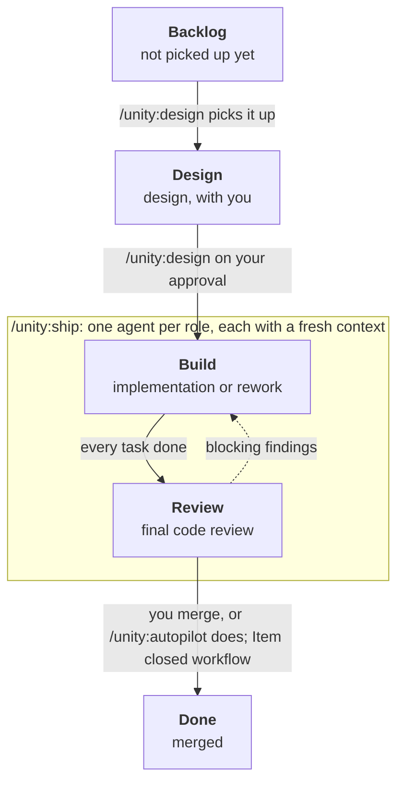

# Unity

**Unity** is a [Claude Code](https://claude.com/claude-code) plugin for a role-based development flow on GitHub: **design → build → review**, plus **`/unity:test`**, which tests the whole project when you choose. Design is a conversation with you; build and review each run as their own agent with a fresh context, one after the other, from a single command. The GitHub issue, its pull request and a Project board are the only handoff between them.

## Motivation

One agent that designs, builds, tests and reviews its own work in a single conversation grades its own homework. Its context fills up with its own reasoning, and the further a session runs, the less that reasoning is questioned. Unity splits the work into agents that don't share a context and don't take each other's word for it: the designer agrees the design and testable acceptance criteria with you, the builder implements them test-first, and the reviewer reads the result as someone who has to maintain it next year. When you choose, for example at the end of an epic, the tester checks the running system as a whole against every shipped story's criteria and turns what it finds into new stories.

The workflow around them is deterministic. Every role reads the same inputs from GitHub, checks the board before it starts, and hands over through a fixed format: verdicts, coverage and counts are computed by scripts, not written by the agent. That is what makes the output scale. Each story arrives as one pull request with one commit per task, mapped to its acceptance criteria, unit-tested and reviewed line by line, whether it is the first story in a project or the hundredth.

## Name

The name **Unity** is a wink to Unity, the hive mind from the Rick and Morty episode [Auto Erotic Assimilation](https://en.wikipedia.org/wiki/Auto_Erotic_Assimilation), who assimilates a whole planet into one perfectly coordinated mind. It fits: like Unity, this plugin makes almost anything possible, as long as you align to the workflow.

## Install

Unity builds on these, which it doesn't install itself:

- [Superpowers](https://github.com/obra/superpowers), for brainstorming, plans, test-driven development, verification and code review: `/plugin install superpowers@claude-plugins-official`
- [GitHub CLI](https://cli.github.com) (`gh`) with access to Projects: `gh auth refresh -s project`
- Node
- for web projects: Playwright and the `playwright-cli` skill

The repository is its own marketplace.

**First time on a machine**, install it at user level, so `/unity:init` is available before a project is set up:

```
/plugin marketplace add vanesterik/unity
/plugin install unity@unity
```

**Per project**, run `/unity:init` once (see [Usage](#usage)). It adds this to the project's `.claude/settings.json`, so the plugin is enabled for that repository and stays up to date:

```json
{
  "extraKnownMarketplaces": {
    "unity": { "source": { "source": "github", "repo": "vanesterik/unity" }, "autoUpdate": true }
  },
  "enabledPlugins": { "unity@unity": true }
}
```

## Usage

1. **Set up the project.** Create a GitHub Project with a **Status** field whose options are exactly `Backlog`, `Design`, `Build`, `Review` and `Done`. A `Test` column left from an older unity does no harm. Then, in Claude Code in the repository:

   ```
   /unity:init <owner> <project-number>
   ```

   It writes `.claude/pipeline.json` with the board's IDs and the project's start and test commands, adds a workflow section to `CLAUDE.md` and `artifacts/` to `.gitignore`, and enables the plugin. It also asks which tests `/unity:test` writes: **integration** tests, **E2E** tests through the browser, or **both**. It proposes an answer from what it finds, and records it as the blocks in `.claude/pipeline.json` and the matching sections in `CLAUDE.md`. It asks you to confirm what it detected, and suggests the commit to make. Run it again to change the choice.

2. **Let the board move merged issues to Done.** This is the only move no role makes, and GitHub's API can't configure it, so you set it once by hand. It works in two links: the pull request that the builder opens has `Closes #<issue>` in its body, so merging it into `main` closes the issue; the board's **Item closed** workflow then sets a closed issue's Status to **Done**. To turn the workflow on:

   1. Open the project board on GitHub and choose **⋯** (top right) > **Workflows**.
   2. Select **Item closed** in the list of default workflows.
   3. Choose **Edit**. Under **When**, keep the filter on issues (`is:issue`, or `is:issue,pr`).
   4. Under **Set**, choose the **Status** field and the value **Done**.
   5. Choose **Save and turn on workflow**. The list now shows it as on.

   `Closes` only works for pull requests into the repository's default branch, so `main` must be the default. `/unity:init` warns when it finds the workflow off.

3. **Write the issue.** A user story as a GitHub issue, added to the board in **Backlog**.

4. **Design it with Claude:**

   ```
   /unity:design <issue>
   ```

   This is the one role you work with. It moves the issue to **Design**, reads the codebase, and works out the design with you, with numbered acceptance criteria (`AC1`, `AC2`, ...) that can be checked from outside the code. A script assembles the design into one comment and checks its sections and criteria. The comment is posted on the issue and read back to make sure it arrived unchanged, while the issue stays in **Design**. You read it on GitHub and approve it in the conversation: that approval is the one human gate in the flow, and only then does the issue move to **Build**. Changes you ask for go up as a new version (v2, v3...).

5. **Ship it**, from the same session:

   ```
   /unity:ship <issue>
   ```

   This runs the builder and the reviewer one after the other, each as its own agent with a fresh context, so none of them sees your design conversation or another role's reasoning. After each agent, it reads the board and goes on only if the issue moved to the next column. You watch nothing in between. At the end it prints one line per role with its result and link, then the column and the next step, written by a script from what the roles posted on GitHub. When it stopped early, it also lists the commits that landed since a role last signed off, so you can see where a failure may come from.

   - **The builder** (`unity:builder`) creates `feature/<issue>-<slug>` from the latest `main` and writes the implementation plan against that code, one commit per task. It implements the plan task by task with unit tests written first, and pushes each task as its own commit to a draft pull request, where it posts the plan as a record. Nobody approves the plan; at handover a script checks it still matches the commits. A script writes the pull request body from the builder's data, with a table that maps every criterion of the design to its code and unit tests. When every task is done, it marks the pull request ready and moves the issue to **Review**. It writes no integration or E2E tests and doesn't run them: a story never waits for them.
   - **The reviewer** (`unity:reviewer`) reviews the whole pull request against the design, runs the unit tests itself, and posts a verdict. It doesn't test the running system. Blocking findings send the issue back to **Build**. An approval leaves it in **Review**, ready for you.

6. **If it stops early**, its report says why, with the stopping role's report below it:

   - **Blocking findings** put the issue back in **Build**. Run `/unity:ship <issue>` again: the builder reworks the findings, and review runs again. Each role runs at most once per `/unity:ship`, so a rework never loops on its own.
   - **A role that stopped** before its work (a leftover test marker, a design without criteria) says what it needs.

   To run a single role instead, use `/unity:build` or `/unity:review`. Each starts its agent the same way, and `/unity:ship` picks up from whatever column the issue is in.

7. **Or let autopilot ship and merge them all**, from the same session:

   ```
   /unity:autopilot
   ```

   When you've approved a few designs, autopilot takes every story in **Build**, top of the column first (drag the cards to set the order), and runs the builder and reviewer on each, as `/unity:ship` does. Then it merges the story. Your design approval stays the one human gate. The merge gate becomes a check a script enforces: `pipeline.js merge` rebase-merges a pull request only when the reviewer's approval is on its head commit and CI is green. Keep integration and E2E tests out of the checks a story's pull request must pass: they belong to `/unity:test`. It waits up to 8 minutes for running checks, and autopilot tries a second time while they still run. When it merges, the issue closes and moves to **Done**, the branch is deleted, and the next story starts from the updated `main`. Leave the session open while it runs.

   - **Rework.** Blocking findings go back to the builder up to `autopilot.maxReworks` times (in `.claude/pipeline.json`, default 2) before the story counts as stuck.
   - **The first stuck story ends the run**, because stories designed together usually depend on each other. That covers a story past its rework limit, a role that stopped, or a merge GitHub refused. The story gets the `autopilot:stopped` label and a comment saying why, and nothing after it starts. A story that stopped in **Build** (past its rework limit, or the builder stopped) moves to **Design**, since that usually means the design didn't hold up; one that stopped in Review stays there.
   - **Coming back.** Deal with the stopped story, then run `/unity:autopilot` again. Revise it with `/unity:design`, or move it back to **Build** to try it again as it is: either way it goes first, with a fresh rework budget. If you finished it with `/unity:ship` and merged it, the run carries on with the rest. While it's still in Design or Review, autopilot starts nothing and says so.
   - **The digest.** The run ends with one summary written by a script: each merged story with its pull request and the commit range it landed on `main` (what you'd revert to undo it), the story it stopped at with every role result of the run, and what still waits in **Build**.
   - **Stories in Review** when the run starts are left alone. Use `/unity:ship` for those.
   - **Where a person must merge**, protect `main` on GitHub (for example, require an approving review from someone other than the author). Autopilot then stops at the refused merge instead of going around it.

8. **Merge**, after `/unity:ship` (autopilot merges for you). Review the pull request commit by commit and merge it with a rebase, so each task stays its own commit on `main`. The `Closes #<issue>` line closes the issue, and the "Item closed" workflow moves it to **Done**. If GitHub doesn't close the issue, close it by hand with a comment on how each criterion was met.

9. **Test the whole project**, when you choose, for example at the end of an epic:

   ```
   /unity:test
   ```

   The tester (`unity:tester`) starts the system and reads the latest design of every closed story. It explores the main flows across stories, plus a smoke set (the system starts, its data loads, each entry point answers), and looks for contradictions between stories' rules. Then it revisits the integration or E2E suite the project chose: it adds what those flows need, rewrites what no longer matches a design, and deletes what only repeats unit tests, so the suite stays small. The changes go on a `test/<date>` branch and pull request, for you to review and merge. Every defect it finds becomes a new story in **Backlog**, with how to reproduce it; the failing test stays in the suite until that story fixes it. It never changes application code.

   The tester may only write tests. A hook enforces this: it writes `artifacts/.test-active` when a run starts and removes it at the end, and while that file exists, edits outside `test.writablePaths` in `.claude/pipeline.json` are blocked. If a run is interrupted, the file stays behind and the builder stops until you delete it.

The agents can't ask you anything mid-run: where a role needs a decision, it stops and hands back. Each role also checks the board first, so a role started on an issue in the wrong column stops. Along the way the issue collects a one-line pointer to each role's result, written by a script from what the role posted, so it reads as a timeline of the story. To see where every issue stands and what to run next, without opening GitHub, run `/unity:status`.

## Board

The board's **Status** field is the workflow state, and each role is named after the column it works in. Design runs in your session; the two roles inside the box run as agents, started by `/unity:ship`. It follows the solid arrows and stops at a dashed one:



You add new issues to **Backlog**, and so does `/unity:test`, for every defect it finds.

Designs live in the issue, as the latest `role:design` comment, and the builder's plan on the pull request, as a `role:plan` comment; neither is a file in the repository. Build and review post on the pull request. Each role output starts with a hidden marker (`<!-- role:review -->`), so the next role finds the latest one.

## Commands

`/unity:init` sets up a project once. `/unity:design`, `/unity:ship` and `/unity:autopilot` run the workflow, `/unity:status` shows where every issue stands, the three role commands run one role each as its agent, and the last three are the skills the roles build on, which you can also run on their own.

| Command | What it does |
| --- | --- |
| `/unity:init <owner> <project>` | Sets up a repository: `.claude/pipeline.json` with the board IDs and the detected start and test commands and the chosen kinds of tests (integration, E2E or both), the `CLAUDE.md` workflow section, `.gitignore`, plugin settings |
| `/unity:design <issue>` | Works out the design and acceptance criteria with you, posts them as one issue comment for you to read on GitHub, and moves the issue to Build once you approve the posted version |
| `/unity:ship <issue>` | Runs the builder and reviewer agents one after the other, from the issue's current column, as long as each one moves it on |
| `/unity:autopilot` | Builds, reviews and merges every story in Build, top first, through `pipeline.js merge`; stops the run at the first story that can't get to `main` and ends with a digest |
| `/unity:status` | Shows every issue on the board per column, with its pull request, latest result and next command, and warns about what the columns don't show; changes nothing |
| `/unity:build <issue>` | Runs the builder agent: plans the approved design against the current code, implements it task by task with test-first unit tests, opens a pull request that maps each criterion to code and tests, and moves the issue to Review; also reworks review findings |
| `/unity:test` | Runs the tester agent on the whole project, when you choose: explores the flows across shipped stories, revisits the integration or E2E suite in a pull request, and files every defect as a story in Backlog |
| `/unity:review <issue or PR>` | Runs the reviewer agent: reviews the whole pull request against the design and criteria, posts a verdict with blocking findings and suggestions, and sends the issue back to Build or leaves it ready to merge |
| `/unity:test-user-story <issue or story>` | Exploratory testing of one story with an evidence report, run by hand |
| `/unity:write-system-test` | Writes and stabilizes scripted integration or E2E tests of the system as a whole, used by the tester; also usable on its own |
| `/unity:get-user-story <issue>` | The issue, its latest design and its acceptance criteria, as the other skills use them |

## License

This project is licensed under the MIT License - see the [LICENSE](LICENSE) file for details.

## Credits

The tester and `test-user-story` stand on the work of [Tim Lolkema](https://github.com/tlolkema), who built and wrote about agentic testing with agent skills. Unity builds on his code and texts with his consent. Thanks, Tim, for sharing them so generously. ❤️

- `test-user-story`, from [tlolkema/demo-webshop](https://github.com/tlolkema/demo-webshop): deriving test cases from a user story, executing them with `playwright-cli`, and the rules for framing screenshot and video evidence. Unity adds criterion IDs on every case, retrying a failure before recording it, and command-line checks.
- The test report, from the same repository: the HTML template and the generator that fills it from the run's data. Unity adds the acceptance-criteria coverage table, a verdict computed by the generator instead of supplied by the agent, and the markdown summary posted on the pull request. The review, build and design generators follow the same pattern.
- `write-system-test`, from his `write-e2e-test` in [tlolkema/skills-explained](https://github.com/tlolkema/skills-explained): turning an executed case into a scripted Playwright test and repeating it until it is stable. Unity moves the project-specific paths into `CLAUDE.md` and `.claude/pipeline.json`, so it works across repositories, adds integration tests as a kind the project can choose instead of or next to E2E, and reports a test that stays flaky instead of hiding it.
- `get-user-story`, from demo-webshop, rewritten to read the issue, its design comment and its acceptance criteria from GitHub.

His articles explain the thinking behind it: [Using agent skills to write Playwright tests](https://tlolkema.substack.com/p/using-agent-skills-to-write-playwright) and [Why you should start using agentic testing](https://tlolkema.substack.com/p/why-you-should-start-using-agentic).
